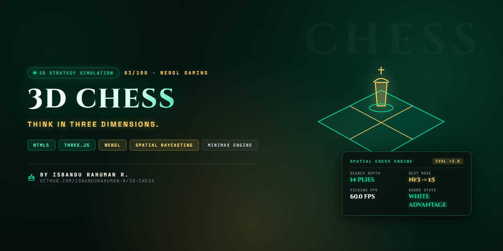
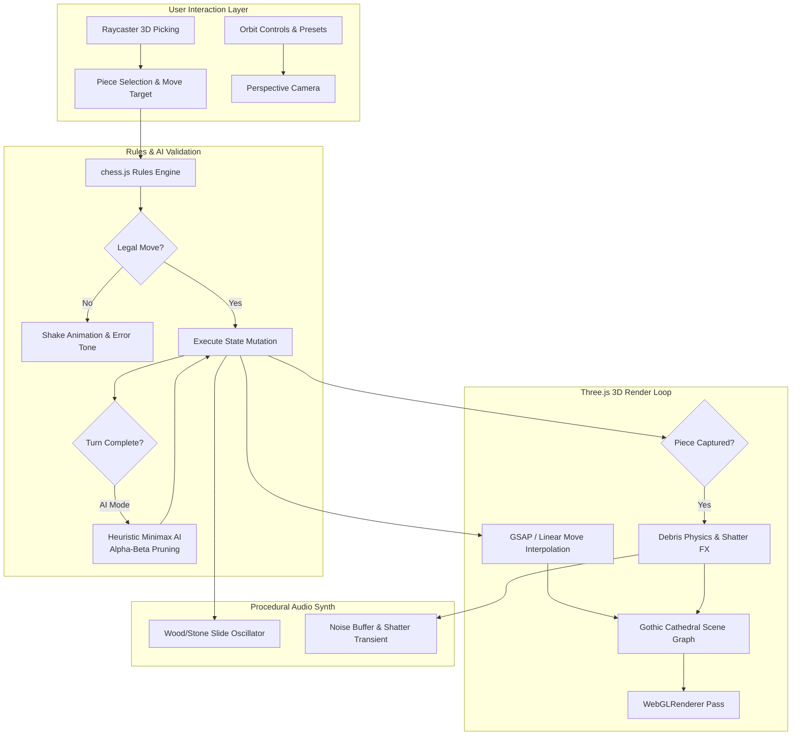

<p align="center">
  
</p>

# ◈ Wizard's Chess 3D — Gothic Cathedral

[](https://github.com/ISBANDURAHUMAN-R/3D-CHESS/actions/workflows/ci.yml)

## ◆ About the Project
Wizard's Chess 3D is a browser-based three-dimensional chess game set inside a vaulted gothic cathedral rendered with Three.js and WebGL. It pairs complete standard chess rules enforcement with cinematic piece-shattering capture animations and real-time procedural audio synthesis.

## ❖ Key Features
- Full standard FIDE chess rules validation using `chess.js`, covering legal moves, check, checkmate, castling, en passant, and pawn promotion.
- Piece-shattering combat animations where captured pieces disintegrate into dynamic 3D physics debris.
- Single-player mode against a heuristic minimax chess AI alongside a local two-player pass-and-play mode.
- Real-time procedural audio synthesizer generating movement slides, impact crashes, and check alerts via the Web Audio API.
- Orbital 3D camera controls with preset viewing perspectives (White, Black, Overhead, Free Orbit).

## ◆ System Architecture


## ⬢ Technologies Used
- Three.js (r128)
- WebGL & HTML5 Canvas
- chess.js
- Tailwind CSS
- Web Audio API

## § Requirements
- Modern web browser with WebGL 2.0 support (Chrome, Edge, Firefox, Safari)

## ▲ Installation & Execution
```bash
# Serve locally via Python
python -m http.server 8000

# Or serve via Node.js
npx serve .
```
Open `http://localhost:8000` in your web browser.

## ※ Developer
Developer: ISBANDU RAHUMAN R  
GitHub: https://github.com/ISBANDURAHUMAN-R
